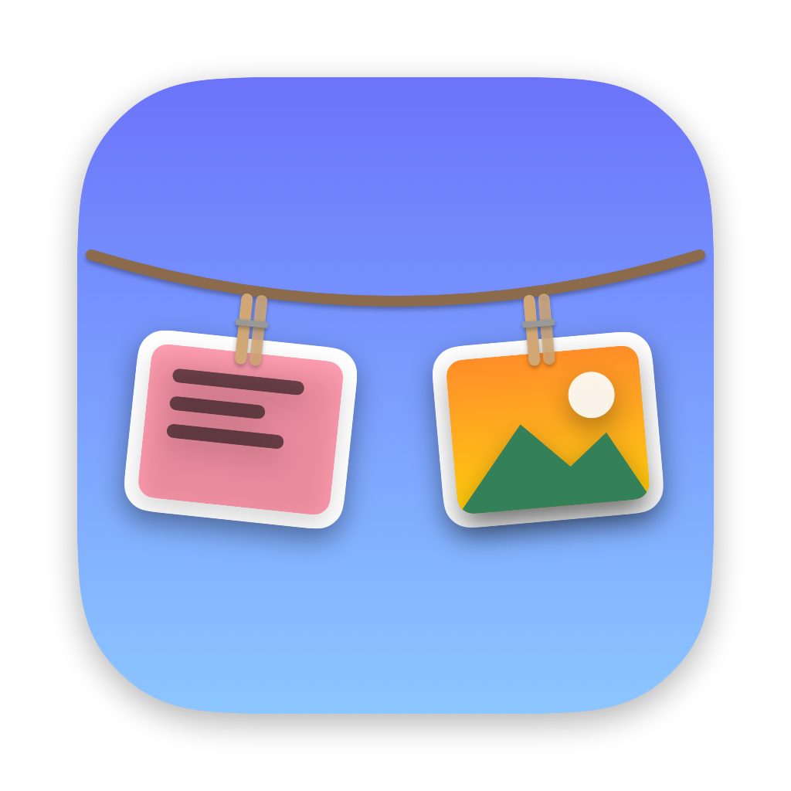

# Saaclipboard

Your clipboard, hung on a clothesline. Copied text and images are pegged to a line along the top of the screen. Move the cursor to the top edge to show it; click an item to paste it into the focused app.


Requires macOS 14+. Auto-paste needs Accessibility permission (System Settings → Privacy & Security → Accessibility); macOS prompts on first click.

## Develop

```sh
swift run
```

## Release

```sh
pnpm release          # 0.1.0 -> 0.1.1; or: minor, major, 1.2.3
```

Bumps the version, tags it, and pushes. The Release workflow then builds the dmg and publishes a GitHub release.

To build locally instead:

```sh
./scripts/package.sh
```

This builds a universal `dist/Saaclipboard.app` plus a `.zip` and `.dmg`. Without options it is ad-hoc signed and only runs on the build Mac.

To ship to other Macs you need a **Developer ID Application** certificate (Apple Developer Program) and a notarytool profile:

```sh
xcrun notarytool store-credentials saaclipboard --apple-id <apple-id> --team-id <team-id>
SIGN_ID="Developer ID Application: <name> (<team-id>)" NOTARY_PROFILE=saaclipboard ./scripts/package.sh
```

Bump `CFBundleShortVersionString` / `CFBundleVersion` in `Support/Info.plist` for each release.
